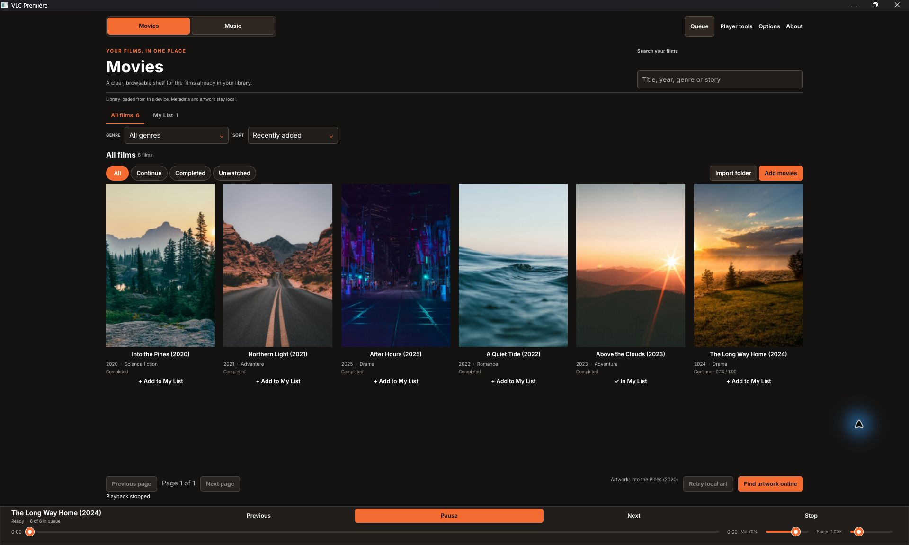
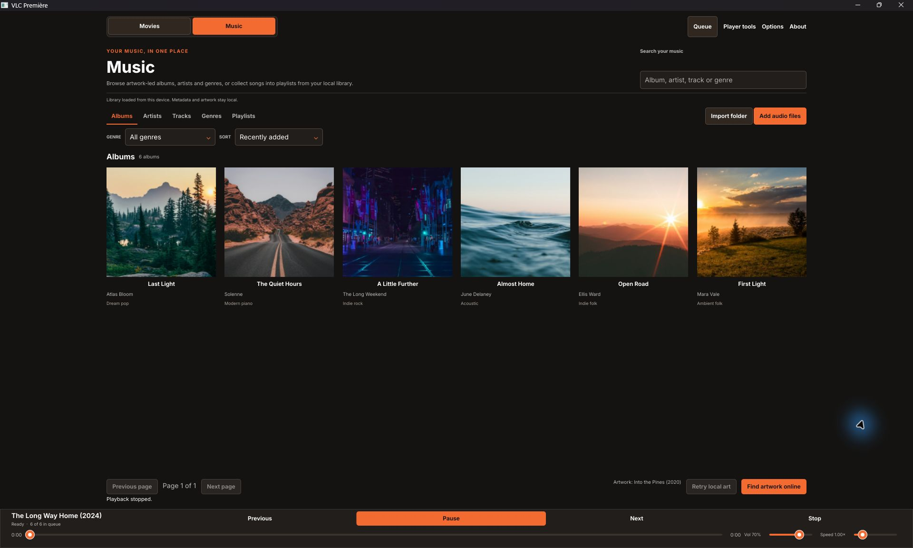

# Rust-VLC

A local movie and music player built with Rust, Slint and libVLC 3, inspired by [VLC Première](https://github.com/benclawbot/VLC-Premiere). Movies and Music share one player, so browsing another collection keeps playback running.

Install a matching VLC 3 runtime with its plugins before launching the app. The installers do not bundle VLC.

## Get the application

Download an installer from the [Rust-VLC v0.1.0 release](https://github.com/benclawbot/Rust-VLC/releases/tag/v0.1.0). Each installer has a matching `.sha256` checksum beside it.

| Platform | Installer | Install |
| --- | --- | --- |
| Linux x86_64 | `rust-vlc-linux-x86_64-installer.tar.gz` (glibc 2.35+) | Extract, then run `./install.sh` |
| Windows x86_64 | `rust-vlc-windows-x86_64-setup.exe` | Run Setup and follow its prompts |
| macOS Apple Silicon | `rust-vlc-macos-arm64.pkg` | Open the package and install Rust-VLC in Applications |
| macOS Intel | `rust-vlc-macos-x86_64.pkg` | Open the package and install Rust-VLC in Applications |

The repository is private, so release downloads require repository access. The macOS packages are unsigned and not notarized; macOS may warn during install or first launch. All platforms need a compatible VLC 3 runtime and plugins for the same CPU architecture as Rust-VLC. The Windows executable includes the MSVC runtime, so it does not need a separate Visual C++ Redistributable. See [runtime setup](packaging/RUNTIME.md) for platform-specific requirements.

Development executables are available from the [Actions workflow](https://github.com/benclawbot/Rust-VLC/actions/workflows/dev-artifacts.yml); those artifacts are for testing and do not replace the installers above.

## Use your library

Add local files or import a folder. Source media is read-only. The application keeps its library, metadata, artwork links, playlists and playback progress in application data directories, outside your media folders.

- **Movies:** browse posters and series/seasons, search, filter watch progress, and resume or start over. Double-click a movie to play fullscreen; Escape or Exit fullscreen returns to the library while playback continues.
- **Music:** browse Albums, Artists, Tracks and Genres with real tags and artwork. Click a song to start its displayed collection at that song. Leading checkboxes select tracks without starting playback; Select all and Play selected use the displayed rows in order.
- **Playlists:** create a named playlist, choose an existing destination for checked tracks, open its contents, reorder/remove entries and shuffle its stored order. An explicit duplicate option preserves repeated songs when wanted. Playlist data survives restart.
- **Playback:** previous/next, play/pause, stop, seek, volume, speed, repeat and playback shuffle. The mini-player uses a centered icon transport with accessible action names. Space toggles play/pause, Left/Right seeks ten seconds, and Ctrl+Left/Right changes media in both the video and music player. Movies play fullscreen with centered previous/play-pause/next icons. Player tools show available audio/subtitle tracks, subtitle files, synchronization delays, jump-to-time, available chapters and fit/fill video display.

Missing files and unavailable VLC plugins remain visible as errors rather than being silently removed from the library. A future database schema is preserved; recognized upgrades first create a recovery backup. Library databases retain native paths and are specific to the operating system that created them.

## Artwork and privacy

Local tags, embedded pictures and nearby `cover`, `folder` or `poster` images are read first. Online artwork requests contain music or movie metadata, never local file paths.

- **Movies and TV:** choose **Options → Artwork** to save a TMDB Read Access Token. It is stored in the operating system credential store (Windows Credential Manager, macOS Keychain, or Linux Secret Service) and never in the library database. `TMDB_READ_TOKEN` remains available for existing environment-based setups.
- **Music:** after local tags are read, the background artwork worker searches public YouTube results with the track title and artist. It applies a thumbnail only when the match is strong, then uses the existing MusicBrainz/Cover Art Archive lookup as a fallback. The fallback can also send the album tag. No per-song YouTube URL is required.

YouTube matching reads bounded public search-page data without running JavaScript or using sign-in cookies. YouTube can change that page format, which may temporarily stop automatic matches until the parser is updated. Missing or ambiguous matches keep the local fallback artwork.

Downloaded artwork is validated, resized and cached. Cached covers remain usable offline; ambiguous matches can produce no artwork. Provider availability and credentials affect online lookup, while local playback continues independently.

This product uses the TMDB API but is not endorsed or certified by TMDB. See [TMDB attribution](https://developer.themoviedb.org/docs/faq).

## Interface

The selected **Archive style** uses Première's Inter typography, dark brown surfaces, white text and orange actions, with a prominent Movies / Music switch at the top left. Focus and selection use the same orange palette. “Archive” is the design style; the movie page is titled **Movies**.

The following screenshots show the native Rust/Slint Movies and Music screens using the selected [Archive design reference](design/proposals/archive.html). The screenshots use an isolated sample library; sample media and metadata are not bundled with the application.





## Build from source

Install the Rust toolchain pinned in `rust-toolchain.toml`, a C/C++ build toolchain with CMake, platform build dependencies and a compatible VLC 3 installation, then run:

```sh
cargo run --locked
```

If VLC is outside a standard installation directory, set `VLC_DIR` to its absolute directory. VLC, its plugins and Rust-VLC must have matching CPU architectures. Arch uses its system VLC installation; Linux multiarch library directories and `/Applications/VLC.app` are also searched.

```sh
cargo fmt --all -- --check
cargo clippy --all-targets --locked -- -D warnings
cargo test --all-targets --locked
cargo build --release --locked
```

The [build workflow](.github/workflows/dev-artifacts.yml) lists Linux build packages and creates the four executable archives on native runners. The [release workflow](.github/workflows/release-installers.yml) builds a Linux tarball installer, Windows Setup executable, and separate Apple Silicon and Intel macOS packages on native runners. Runtime-dependent tests are explicitly ignored by the default suite and run separately when VLC, codecs or network access are available.

## Review and remaining work

[Validation](docs/VALIDATION.md) records exact checks and platform gates. The [source audit](docs/SOURCE_AUDIT.md) and [implementation plan](docs/IMPLEMENTATION_PLAN.md) track desktop behavior against VLC Première. Implementation workers use **GPT-6 Luna, Max**; independent review uses **GPT-6.1 Sol, xhigh**.

This build does not claim complete Android parity. Equalizer, bookmarks, A–B repeat, sleep timer, frame capture, subtitle search/download, network shares/streams, casting, remote access and OS media integration remain follow-on work. Queue restoration, persistent library roots, scan reconciliation, playlist import/export and dedicated movie-genre metadata also remain open. Native Arch Wayland/X11 and macOS playback qualification and signed installation packages remain open gates; see [the parity review](docs/UX_PARITY_REVIEW.md) for the current comparison.

The application license has not been selected. Inter's [OFL notice](assets/fonts/OFL.txt) ships with executable packages. VLC is installed separately; review dependency and runtime terms before redistribution.
